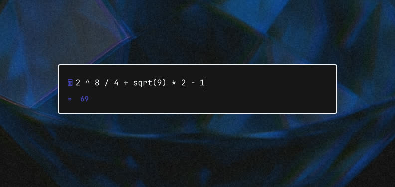

# Calculator for Omarchy

A live calculator overlay for the Omarchy 4 shell. Type an expression and the answer appears as you type, powered by [qalc](https://qalculate.github.io/) (libqalculate): arithmetic, functions, units, currencies, dates and more.



## Install

```bash
omarchy pkg add libqalculate   # provides qalc, if you don't have it yet
omarchy plugin add https://github.com/<you>/kq-calc.git --enable
```

Plugins can't add keybindings, so bind one in `~/.config/hypr/bindings.lua`:

```lua
o.bind("SUPER + Q", "Calculator", "omarchy-shell shell toggle kq.calc")
```

Omarchy's default `SUPER + CTRL + Q` opens its own calculator. To use that key for this one instead:

```lua
hl.unbind("SUPER + CTRL + Q")
o.bind("SUPER + CTRL + Q", "Calculator", "omarchy-shell shell toggle kq.calc")
```

## Keys

| Key | Action |
|-----|--------|
| Enter | Copy the result to the clipboard and close |
| Esc | Close |
| Up / Down | Walk through previous expressions |
| Ctrl+U | Clear the input |
| Ctrl+W | Delete the word before the cursor |

History is kept in `~/.local/state/kq-calc/history` (last 200 expressions).

## Update and remove

```bash
omarchy plugin update kq.calc
omarchy plugin remove kq.calc
```

## License

MIT
